# Old domain references: luxecliniqueaesthetics → luxeclinique.com

Every place the project still says `luxecliniqueaesthetics` (13 in total). The old name is highlighted in red in each screenshot.

| # | File | Line | Action |
|---|---|---|---|
| 1 | `src/content/site.ts` | 11 | Change |
| 2 | `DEPLOY_VERCEL.md` | 44 | Change |
| 3 | `DEPLOY_VERCEL.md` | 56 | Change |
| 4 | `DEPLOY_VERCEL.md` | 58 | Change |
| 5 | `README.md` | 3 | Change |
| 6 | `vercel.json` | 84 | Keep (redirect) |
| 7 | `docs/SEO.md` | 58 | Keep (redirect) |
| 8 | `docs/GOOGLE_BUSINESS_PROFILE.md` | 62 | Keep (redirect) |
| 9 | `src/content/site.ts` | 29 | Gmail – optional |
| 10 | `scripts/enquiry-apps-script.gs` | 13 | Gmail – optional |
| 11 | `DEPLOY_VERCEL.md` | 53 | Gmail – optional |
| 12 | `docs/APPROVALS.md` | 24 | Gmail – optional |
| 13 | `docs/BOOKING_FORM_SETUP.md` | 8 | Gmail – optional |

## 1. Change to luxeclinique.com

These still point at the old website address. Replace `luxecliniqueaesthetics.com` with `luxeclinique.com`. Also set `NEXT_PUBLIC_SITE_URL` to `https://www.luxeclinique.com` in Vercel.

### 1. `src/content/site.ts`, line 11

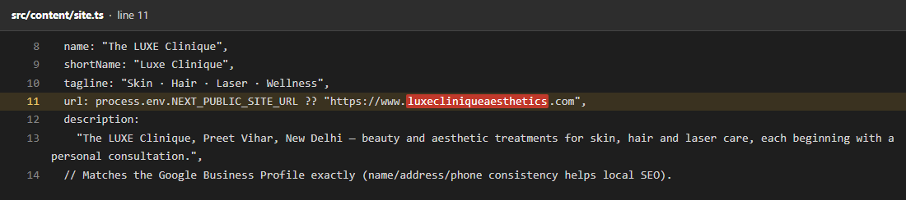

### 2. `DEPLOY_VERCEL.md`, line 44

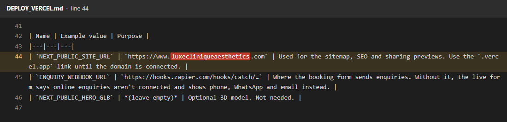

### 3. `DEPLOY_VERCEL.md`, line 56

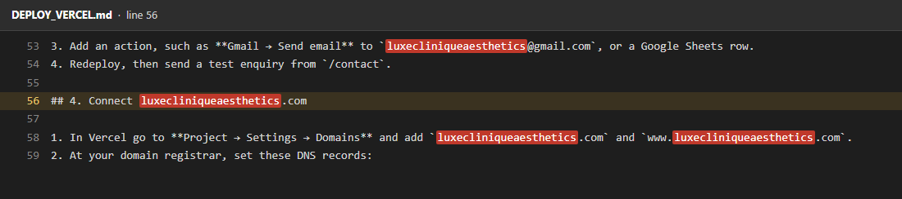

### 4. `DEPLOY_VERCEL.md`, line 58

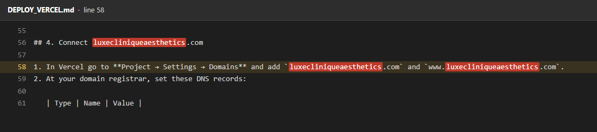

### 5. `README.md`, line 3

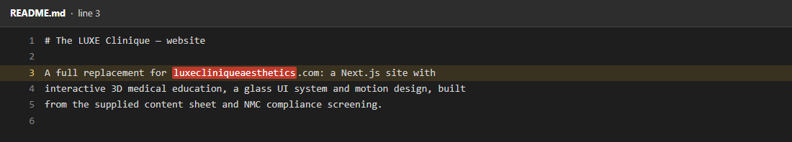

## 2. Keep as they are (redirect from the old domain)

These deliberately name the old domain so visitors and Google are sent on to www.luxeclinique.com. Do not change them.

### 6. `vercel.json`, line 84

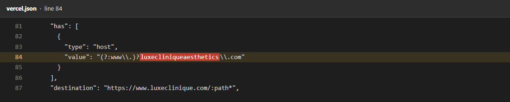

### 7. `docs/SEO.md`, line 58

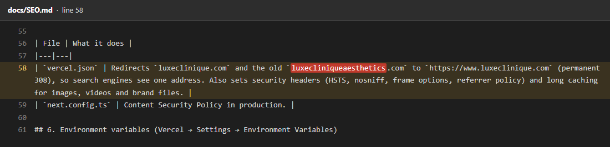

### 8. `docs/GOOGLE_BUSINESS_PROFILE.md`, line 62

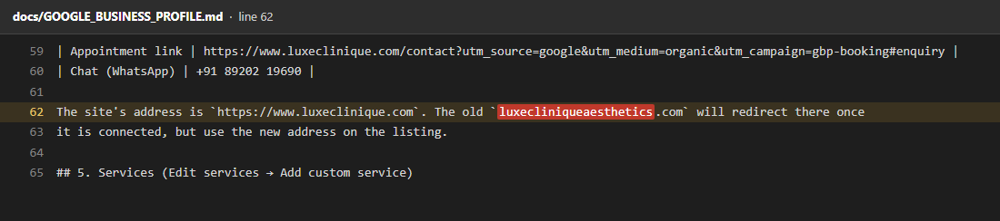

## 3. Gmail address (not the website domain)

This is the inbox `luxecliniqueaesthetics@gmail.com`. Change it only if a new address such as `hello@luxeclinique.com` is set up and working.

### 9. `src/content/site.ts`, line 29

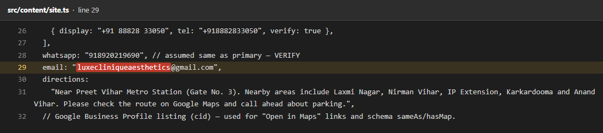

### 10. `scripts/enquiry-apps-script.gs`, line 13

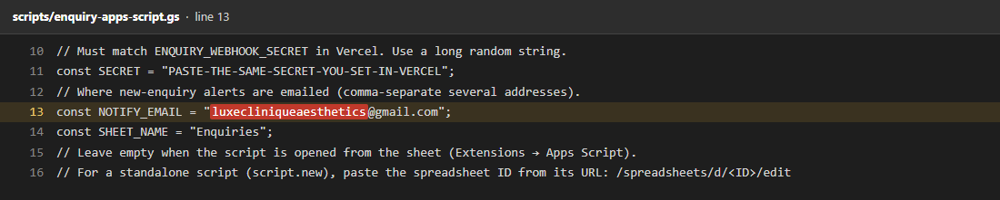

### 11. `DEPLOY_VERCEL.md`, line 53

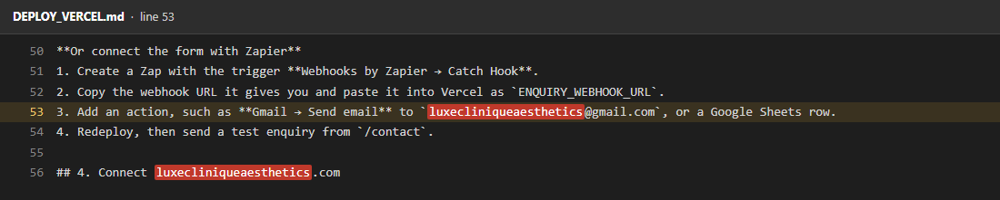

### 12. `docs/APPROVALS.md`, line 24

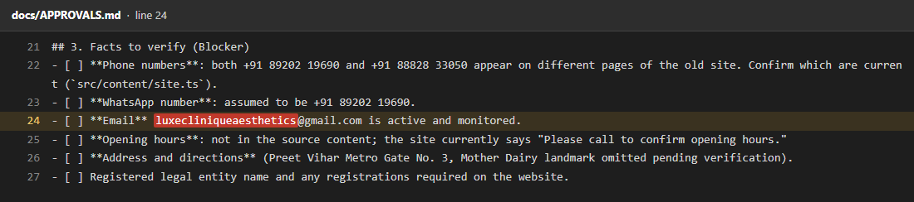

### 13. `docs/BOOKING_FORM_SETUP.md`, line 8

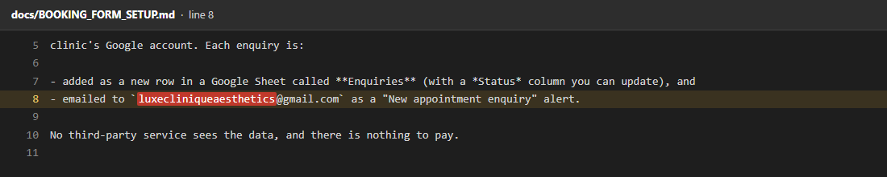
